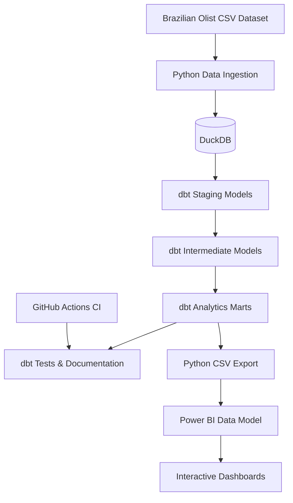
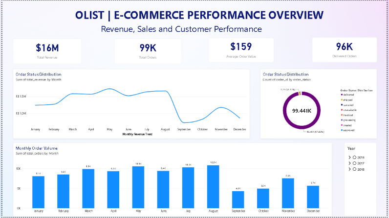
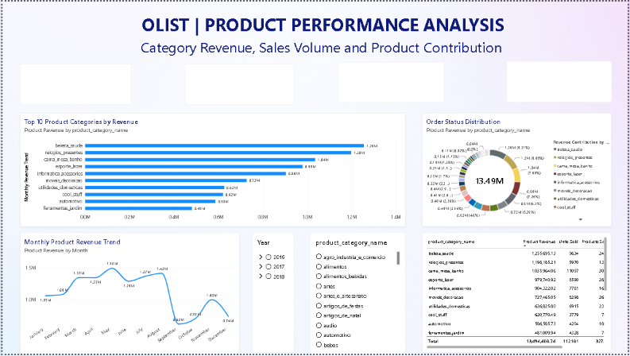
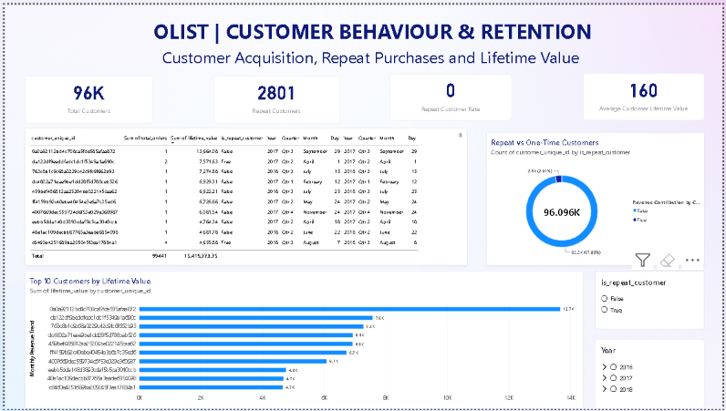
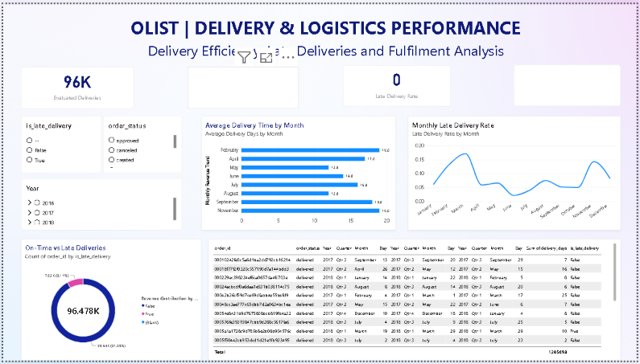

# Olist E-commerce Analytics Engineering

**An end-to-end analytics engineering project transforming Brazilian e-commerce transaction data into tested, documented, analytics-ready datasets and interactive Power BI dashboards.**

[GitHub Repository](https://github.com/sakshi-nandgude/olist-dbt-analytics)

---

## Project Overview

This project builds an end-to-end analytics workflow using the Brazilian Olist e-commerce dataset.

The objective is to transform raw transactional data into reliable analytical models that support business analysis across four areas:

- **Sales Performance:** Revenue trends, order volume and average order value.
- **Product Performance:** Category-level revenue, units sold and product contribution.
- **Customer Behaviour:** Repeat purchasing, customer lifetime value and order frequency.
- **Delivery Performance:** Delivery duration, late deliveries and on-time performance.

Rather than querying raw transactional data directly in a dashboard, this project uses a layered dbt architecture to organise transformations, apply data-quality checks and create reusable business models before visualisation.

## Architecture



## Technology Stack

| Technology | Purpose |
|---|---|
| Python | Data ingestion and analytical dataset exports |
| SQL | Data transformation and business logic |
| dbt Core | Modular modelling, testing and documentation |
| DuckDB | Local analytical database |
| Power BI | Data modelling, DAX measures and dashboards |
| Git & GitHub | Version control and project management |
| GitHub Actions | Automated CI validation |

## Data Transformation Architecture

The dbt project follows a layered modelling approach to separate source preparation, business transformations and reporting logic.

### 1. Staging Layer

Prepares raw source data for downstream transformations.

Responsibilities include:

- Standardising source column names and data types.
- Preparing customer, order, product and order-item data.
- Creating consistent source-level models for reuse.

### 2. Intermediate Layer

Combines and enriches transactional data to implement reusable business logic.

Key models include:

| Model | Purpose |
|---|---|
| `int_order_items_enriched` | Enriches order items with order, product and customer information; calculates item value and late-delivery indicators. |
| `int_orders_aggregated` | Aggregates order-level information from transactional data. |

### 3. Marts Layer

Creates business-facing models designed for reporting and analysis.

| Model | Purpose |
|---|---|
| `dim_customers` | Customer-level metrics, including order frequency, repeat-customer status and lifetime value. |
| `dim_products` | Product-level descriptive information for product analysis. |
| `fct_orders` | Order-level fact model containing revenue, delivery and order-status metrics. |
| `mart_monthly_revenue` | Monthly revenue and order performance aggregates. |

The resulting models provide a structured foundation for Power BI reporting.

## Data Quality, Testing & Reliability

Data quality is incorporated into the transformation workflow rather than being treated as a final dashboard check.

The project includes:

- **Generic dbt tests:** Validation of model and column-level data quality.
- **Custom SQL tests:** Business-specific validation rules.
- **Delivery validation:** Checks for invalid delivery date sequences.
- **Revenue reconciliation:** Comparison of order-level revenue with underlying transactional values.
- **Monthly reconciliation:** Validation of monthly order counts against the underlying order data.
- **Incremental processing:** `fct_orders` uses a 30-day purchase-date lookback with a `delete+insert` strategy to process recent data changes.
- **Model documentation:** Descriptions for models and columns, with generated dbt documentation and lineage.

## Continuous Integration

GitHub Actions is configured to validate the dbt project through an automated workflow.

The CI setup uses a synthetic DuckDB fixture to support automated validation without relying on the full local dataset.

This demonstrates how transformation checks can be incorporated into a version-controlled development workflow.

## Power BI Analytics

The final reporting layer is an interactive Power BI dashboard consisting of four analytical pages.

### 1. Executive Overview

Provides a high-level view of overall e-commerce performance.

**Key metrics:**

- Total revenue
- Total orders
- Average order value
- Delivered and cancelled orders
- Monthly revenue trends
- Monthly order volume
- Order status distribution



### 2. Product Analytics

Explores product and category performance.

**Key metrics and analysis:**

- Product revenue
- Units sold
- Number of products sold
- Top-performing product categories
- Category revenue contribution
- Monthly product revenue trends



### 3. Customer Analytics

Examines customer purchasing behaviour and customer value.

**Key metrics and analysis:**

- Total customers
- Repeat customers
- Repeat customer rate
- Average customer lifetime value
- Average orders per customer
- Customer purchasing frequency
- Top customers by lifetime value



### 4. Delivery & Logistics Analytics

Evaluates order fulfilment and delivery performance.

**Key metrics and analysis:**

- Evaluated deliveries
- Late deliveries
- Late delivery rate
- On-time deliveries
- Average delivery duration
- Monthly delivery performance



## Project Structure

```text
olist-dbt-analytics/
│
├── .github/
│   └── workflows/          # GitHub Actions CI workflow
│
├── models/
│   ├── staging/            # Source-level transformations
│   ├── intermediate/       # Reusable business logic
│   └── marts/              # Reporting-ready models
│
├── tests/                  # Custom SQL data-quality tests
│
├── scripts/
│   └── export_to_powerbi.py
│
├── powerbi/                # Power BI report
├── screenshots/            # Dashboard screenshots
│
├── dbt_project.yml
├── requirements.txt
├── .gitignore
└── README.md
```

*Adjust this structure if your actual repository contains additional folders or different paths.*

## Running the Project Locally

### Prerequisites

- Python
- Git
- A configured dbt profile using the DuckDB adapter
- The Olist source dataset

### 1. Clone the Repository

```bash
git clone https://github.com/sakshi-nandgude/olist-dbt-analytics.git
cd olist-dbt-analytics
```

### 2. Create a Virtual Environment

```bash
python -m venv .venv
```

Activate it on Windows:

```bash
.venv\Scripts\activate
```

### 3. Install Dependencies

```bash
pip install -r requirements.txt
```

### 4. Configure dbt

Configure the DuckDB connection in your local dbt profile under `~/.dbt/profiles.yml`, using the profile name and database path expected by `dbt_project.yml`.

Verify the connection:

```bash
dbt debug
```

### 5. Load Source Data

Place the required Olist source files in the expected local data location and execute the project's data-ingestion workflow to populate DuckDB.

### 6. Run dbt Transformations

```bash
dbt run
```

### 7. Execute Data-Quality Tests

```bash
dbt test
```

### 8. Generate dbt Documentation

```bash
dbt docs generate
dbt docs serve
```

### 9. Export Datasets for Power BI

```bash
python scripts/export_to_powerbi.py
```

The export script generates the following analytical datasets:

- `orders.csv`
- `customers.csv`
- `products.csv`
- `monthly_revenue.csv`
- `product_sales.csv`

Open the Power BI report in the `powerbi/` directory and refresh the imported datasets.

---

## Key Skills Demonstrated

### Analytics Engineering

- Layered data modelling
- dbt Core and modular SQL transformations
- Fact and dimension modelling
- Incremental data processing

### Data Quality & Reliability

- Generic and custom SQL tests
- Revenue and order reconciliation
- Data validation
- Automated CI workflows

### Business Intelligence

- Power BI data modelling
- DAX measures and calculated KPIs
- Interactive dashboard design
- Customer, product, sales and logistics analytics

### Development Practices

- Python scripting
- DuckDB
- Git version control
- GitHub Actions
- Technical documentation

## Future Enhancements

- Automate scheduled data ingestion and dashboard refreshes.
- Extend customer analysis with cohort and retention modelling.
- Introduce more advanced product and customer segmentation.
- Explore cloud deployment for scalable analytical workloads.

---

## Author

**Sakshi Vijay Nandgude**

MSc Business Analytics | University of Limerick

[GitHub](https://github.com/sakshi-nandgude)
